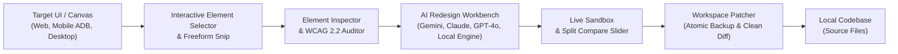

# Visual UI-AI Studio

<p align="center">
  <strong>Multi-Platform Visual Component Inspector, AI Redesign Workbench & Atomic Local Workspace Patcher</strong>
</p>

<p align="center">
  
  
  
  
  
  
  
  
</p>

---

## 🌟 Overview

**Visual UI-AI Studio** is a modern visual workbench designed for developers, UI engineers, and product designers. It bridges the gap between rendered visual UI elements and source code by allowing users to inspect, snip, and redesign components across **Web**, **Mobile (Android ADB)**, and **Desktop** environments, perform automated **WCAG 2.2 accessibility audits**, preview interactive redesigned components in real time with a **Split Before/After Comparison Slider**, and safely patch modifications back to the local codebase with **atomic backups and instant rollback**.

---

## 🏗️ Architecture & Dataflow



---

## ✨ Core Features

### 1. Multi-Platform Canvas & Component Selector
- **Interactive Inspection:** Click on any component inside the canvas to extract DOM hierarchy, computed typography, background color, text color, and border tokens.
- **Universal Freeform Snip Tool:** Click and drag a rectangular bounding box across any area of the canvas to snip custom UI regions for AI transformation.
- **Multi-Platform Support:**
  - **Web Applications:** Inspect live web applications or preloaded responsive templates.
  - **Mobile (Android ADB):** Native bridge connecting to physical devices and emulators via `adb` to dump UIAutomator view hierarchies and real-time screen captures. Includes dynamic device aspect scaling and simulated fallback modes.
  - **Desktop Applications:** High-resolution desktop dashboard canvas with server metrics and telemetry widgets.
- **Coordinate-True Viewport Math:** Viewport scaling and zoom (`0.25x` to `2.0x`) preserve exact bounding box positions without negative coordinate shifts or off-screen overflow.

### 2. Automated WCAG 2.2 Accessibility Engine
- **Precise Contrast Calculation:** Evaluates relative luminance under WCAG 2.2 standards for both normal and large text.
- **Compliance Scoring:** Automatically grades contrast against **AA Normal (4.5:1)**, **AA Large (3.0:1)**, and **Enhanced AAA (7.0:1)** thresholds.
- **Touch Target Auditor:** Flags interactive elements that do not satisfy the minimum recommended `44×44px` physical touch target requirement.
- **One-Click Remediation:** AI shortcut button instantly generates compliant color tokens and expanded padding when contrast or touch target criteria fail.

### 3. AI Redesign Workbench & Split Compare
- **Multi-Model Provider Architecture:**
  - **Google Gemini 2.0 / 1.5**
  - **Anthropic Claude 3.5 Sonnet**
  - **OpenAI GPT-4o**
  - **Smart Local Engine:** Built-in offline fallback engine providing rapid, dependency-free redesigns with contextual styling without needing external API keys.
- **Quick Preset Workflows:** Preconfigured prompts for *Modern Glassmorphism*, *Fix WCAG Contrast*, *Clean Minimalist*, *Dark Mode*, and *Mobile Touch-First*.
- **Interactive Split Compare Slider:** Side-by-side Before/After comparison view with a draggable divider handle to inspect visual design improvements against the original implementation.
- **Live Preview Sandbox:** View redesigned components across responsive breakpoints (Mobile 375px, Tablet 768px, Desktop 100%) with tabbed source code and line-by-line diff views.

### 4. Safe Local Codebase Grounding & Atomic Patcher
- **Workspace Search:** Indexes and scores components by class name, tag name, text content, and token frequency.
- **Single-Module Clean Synthesis:** Automatically synthesizes self-contained module replacements to eliminate duplicate imports (`import React`) or duplicate interface declarations.
- **Atomic Backup System:** Creates timestamped `.bak-TIMESTAMP` copies before modifying any file on disk.
- **Instant Rollback:** One-click rollback button to immediately revert applied patches and restore files to their exact prior state.
- **CRLF/LF Normalization:** Normalizes line endings across operating systems to ensure zero false additions or deletions in diff calculations.

---

## 📁 Repository Structure

```
visual_uiai/
├── client/                      # React 18 + TypeScript + Vite + Tailwind CSS
│   ├── src/
│   │   ├── components/
│   │   │   ├── canvas/          # VisualCanvas (Bounding boxes, zoom, snip tool, split slider)
│   │   │   ├── chat/            # AIChatPanel (Prompt presets, streaming chat interface)
│   │   │   ├── inspector/       # ElementInspector (Design tokens & WCAG audit)
│   │   │   ├── layout/          # Header (Platform switcher & studio controls)
│   │   │   ├── modals/          # AdbModal, WebUrlModal, WorkspaceModal
│   │   │   ├── preview/         # LivePreview (Responsive sandbox, code view, diff tabs)
│   │   │   └── workspace/       # PatchReviewModal (Diff review & safe file rollback)
│   │   ├── services/            # api.ts (REST client for backend endpoints)
│   │   ├── types/               # TypeScript models (Element, BoundingBox, Platform, etc.)
│   │   ├── utils/               # wcagUtils.ts, diffUtils.ts
│   │   ├── App.tsx              # Main studio workbench coordinator
│   │   └── App.test.tsx         # Frontend integration & component tests
│   ├── package.json
│   ├── tailwind.config.js
│   └── vite.config.ts
├── server/                      # Node.js + Express 5 + TypeScript + ADB + AI services
│   ├── src/
│   │   ├── routes/              # workspaceRoutes, adbRoutes, aiRoutes, captureRoutes
│   │   ├── services/            # workspacePatcherService, adbService, aiService
│   │   ├── types/               # Server-side TypeScript interfaces
│   │   ├── index.ts             # Express server entry point & middleware
│   │   ├── services/aiAndAdb.test.ts
│   │   └── services/workspacePatcherService.test.ts
│   ├── package.json
│   └── tsconfig.json
├── sample-workspace/            # Live target workspace for testing code patching
│   └── src/components/
│       ├── Card.tsx             # Legacy styled feature card
│       ├── Navbar.tsx           # Navigation bar component
│       └── MetricWidget.tsx     # Desktop dashboard telemetry component
├── .gitignore                   # Standard exclusion rules
├── package.json                 # Monorepo root orchestration scripts
└── README.md                    # Comprehensive documentation
```

---

## 🚀 Quickstart Guide

### Prerequisites
- **Node.js:** v18.0.0 or higher
- **npm:** v9.0.0 or higher
- *(Optional)* **Android SDK Platform-Tools (`adb`)** for physical mobile device inspection.

### 1. Installation
Clone the repository and install all dependencies:
```bash
git clone https://github.com/Saurabh-singhx/visual-Ui_Ai.git
cd visual-Ui_Ai

# Install root, client, and server dependencies
npm install
cd client && npm install
cd ../server && npm install
cd ..
```

### 2. Running Automated Tests
Run the comprehensive Vitest test suite across client and server:
```bash
npm test
```
> All 38 unit and integration tests will run and pass cleanly.

### 3. Launch Development Servers
Start both backend and frontend development servers concurrently:
```bash
# Terminal 1: Start backend API server (runs on http://localhost:3001)
npm run dev:server

# Terminal 2: Start frontend client (runs on http://localhost:5173)
npm run dev:client
```
Open **`http://localhost:5173`** in your browser to launch Visual UI-AI Studio.

### 4. Build for Production
To produce production-ready static assets and compiled server JavaScript:
```bash
npm run build
```

---

## ⚙️ Configuration (Optional)

The application includes an intelligent offline local heuristics engine enabled by default. To connect live external LLM providers, create a `server/.env` file:

```env
# Port Configuration
PORT=3001

# Google Gemini API Key
GEMINI_API_KEY=your_gemini_api_key_here

# Anthropic Claude API Key
ANTHROPIC_API_KEY=your_anthropic_api_key_here

# OpenAI GPT-4o API Key
OPENAI_API_KEY=your_openai_api_key_here
```

---

## 🧪 Testing & Verification

The suite includes **38 automated unit and integration tests** verifying:
- **WCAG Calculation:** Relative luminance, AA/AAA contrast ratios, hex color normalizations (`#fff`, `#ffffff`, `#ffff`), and rgba edge cases.
- **Diff Engine:** Exact additions/deletions, multi-line changes, and CRLF line normalization.
- **AI Classification:** Component classification ensuring cards with child buttons are not falsely overridden into simple action buttons.
- **Workspace Patcher:** Single-module clean replacement, duplicate import prevention, timestamped backup creation, and rollback restoration.
- **Element Selector & Studio Workflow:** Canvas element selection, platform switching, modal dialogues, and responsive dashboard layouts without coordinate overflow.

---

## 📄 License

This project is open-source and available under the [MIT License](LICENSE).
