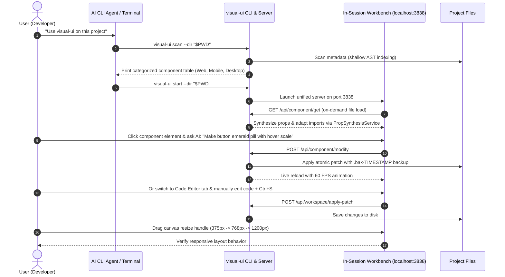

# Visual UI - AI Agent Skill & Workbench

<p align="center">
  <strong>Autonomous Multi-Platform UI Component Inspector, In-Session AI Modifier & Responsive Testing Workbench for AI Agents</strong>
</p>

<p align="center">
  
  
  
  
  
  
  
  
</p>

---

## 🌟 Overview

**`visual-ui`** is an AI Agent Skill and unified visual workbench designed for CLI agents (such as Antigravity `agy`, Gemini CLI, Claude Code) and developers. When invoked on any repository, it automatically indexes all UI components across **Web**, **Mobile**, and **Desktop** projects, renders them in a live browser session with AST-level mock prop synthesis, enables interactive element-level click inspection, allows both prompt-driven AI modifications (including 60 FPS animated transitions) and direct manual code editing, and provides a resizable canvas to verify responsive layout fluidity across breakpoints.

---

## 🏗️ Architecture & Interaction Flow



---

## ✨ Core Features

### 1. Multi-Platform Component Discovery
* **Web**: React (`.tsx`, `.jsx`), Vue (`.vue`), Svelte (`.svelte`), HTML (`.html`).
* **Mobile**: React Native (`react-native` imports, `<View>`, `<Text>`), Flutter (`.dart` widgets), Android XML layouts (`<LinearLayout>`, `<ConstraintLayout>`).
* **Desktop**: Electron and Tauri app windows, desktop dashboard views.
* **Strict Exclusions**: Automatically excludes tests (`*.test.*`, `*.spec.*`, `__tests__`), `node_modules`, `dist`/`build`/`.next`, state stores (Redux, Zustand), and utility helpers.

### 2. Large-Codebase & Monorepo Scalability
* **Metadata-Only Scanning**: Performs shallow reads without loading entire file bodies into memory.
* **High-Volume Threshold (>30 Components)**: Detects enterprise repositories, sets `exceedsThreshold: true`, and prompts the agent/user to scope via `--focus <subfolder>`.
* **Config Support**: Respects project-level `.visual-ui.json` and `.agents/visual-ui.json` include/exclude rules.

### 3. Agent-Decided Rendering & Prop Synthesis (`PropSynthesisService`)
* **Arbitrary Code Injection**: AI agents can inject component code directly via `POST /api/canvas/render`.
* **AST-Level Prop Mocking**: Analyzes component TypeScript interfaces to synthesize realistic props for nested objects, arrays, and callbacks.
* **Import Adaptation**: Strips broken static asset imports and transforms subcomponents into visual styled primitives so components render cleanly without crashing.

### 4. User Manual Code Editor (`CodeEditor.tsx`)
* **Direct Hand Editing**: Integrated code editor tab alongside the AI prompt panel.
* **Developer Controls**: Syntax line numbers, 2-space tab indentation, real-time dirty state tracking, and keyboard shortcut `Ctrl+S` / `Cmd+S`.
* **Instant Persistence & Revert**: Persists changes to disk with automatic timestamped `.bak-TIMESTAMP` backups and live-reloads the canvas instantly.

### 5. In-Session AI Modifications (With 60 FPS Animations)
* **Prompt-Driven Changes**: Request styling, layout, or copy changes directly in the active session.
* **Animation Support**: Supports Tailwind transition utilities (`transition-all duration-300 ease-in-out`, `hover:scale-105`, `animate-pulse`, `animate-bounce`), CSS keyframes, and Framer Motion.
* **Live DOM Execution**: Runs at 60 FPS in the browser DOM for immediate interactive hover and click testing.

### 6. Resizable Responsive Canvas
* **Fluid Width Drag Handle**: Drag freely from 320px to 1920px+.
* **One-Click Breakpoint Presets**:
  * 📱 **Mobile** (375px)
  * 📱 **Tablet** (768px)
  * 💻 **Desktop** (1200px)
* **Live Dimensions Badge**: Real-time width and height readout.

---

## 📁 Repository Structure

```
visual_uiai/
├── bin/
│   └── visual-ui.js             # Standalone CLI runner (scan, start, modify, render)
├── skills/
│   └── visual-ui/
│       └── SKILL.md             # Antigravity AI Agent Skill definition & runbooks
├── scripts/
│   └── install-skill.sh         # Global skill installer (~/.gemini/config/skills/visual-ui)
├── client/                      # React 18 + TypeScript + Vite + Tailwind CSS
│   ├── src/
│   │   ├── components/
│   │   │   ├── canvas/          # VisualCanvas (Responsive drag handles, breakpoints, stage)
│   │   │   ├── editor/          # CodeEditor (In-dashboard user manual code editor)
│   │   │   ├── chat/            # AIChatPanel (In-session prompt & animation presets)
│   │   │   ├── inspector/       # ElementInspector (Element selection & styling)
│   │   │   ├── layout/          # Header (Streamlined platform switcher)
│   │   │   └── preview/         # LivePreview (DOM sandbox extraction & diff view)
│   │   ├── services/            # api.ts (REST client for unified server endpoints)
│   │   ├── types/               # TypeScript interfaces
│   │   └── App.tsx              # Main workbench coordinator
│   └── package.json
├── server/                      # Node.js + Express 5 + TypeScript unified backend
│   ├── src/
│   │   ├── routes/              # workspaceRoutes (scan, get, modify, render, rollback)
│   │   ├── services/            # propSynthesisService, workspacePatcherService, aiService
│   │   ├── types/               # Server-side TypeScript interfaces
│   │   └── index.ts             # Unified server entry point (port 3838)
│   └── package.json
├── test/
│   └── e2e/                     # 156 comprehensive Tier-1 E2E tests & fixtures
│       ├── fixtures/            # Web, Mobile (RN, Flutter, Android), Desktop, Monorepo fixtures
│       ├── harness/             # CLI, Server, API, and Assertion harnesses
│       ├── tier1-feature-coverage/ # 8 E2E test suites
│       └── run-all.sh           # E2E test runner
├── sample-workspace/            # Live target workspace for testing code patching
├── vitest.e2e.config.ts         # Vitest E2E configuration
├── package.json                 # Monorepo root orchestration & bin mapping
└── README.md                    # Comprehensive documentation
```

---

## 🚀 Quickstart & Usage

### 1. Installation

```bash
git clone https://github.com/Saurabh-singhx/visual-Ui_Ai.git
cd visual-Ui_Ai

# Install root, client, and server dependencies
npm install
cd client && npm install
cd ../server && npm install
cd ..

# Build production bundles
npm run build
```

### 2. Install as an Antigravity AI Agent Skill

Run the installer script to register the skill globally in `~/.gemini/config/skills/visual-ui` and symlink `visual-ui` to `~/.local/bin/visual-ui`:

```bash
bash scripts/install-skill.sh
```

### 3. CLI Commands

```bash
# Scan and list components in any project
visual-ui scan --dir ./my-project

# Scan with subfolder focus or JSON output
visual-ui scan --dir ./my-project --focus "src/components" --format json

# Start the interactive workbench on port 3838
visual-ui start --dir ./my-project --port 3838

# Modify a component directly via CLI prompt
visual-ui modify --file "./my-project/src/Card.tsx" --prompt "Make button emerald rounded pill"
```

### 4. Asking Your AI Agent in the Terminal

In any project workspace, ask your AI CLI agent (e.g. `agy`, Gemini CLI, Claude Code):
> *"Use visual-ui to inspect UI components in this project and let's test responsive changes"*

The agent will automatically execute `visual-ui scan`, report the inventory, launch `visual-ui start`, and guide you through visual selection and modifications.

---

## 🧪 Testing & Verification

The suite includes **278 automated unit, integration, and E2E tests** passing at 100%:

```bash
# Run unit & integration tests (122 tests)
npm test

# Run full end-to-end test suite (156 tests)
npm run test:e2e
```

| Test Suite | Tests | Result |
| :--- | :---: | :---: |
| **Server Unit & Services** (`aiService`, `propSynthesisService`, `workspacePatcher`) | 96 | ✅ 100% Passed |
| **Client Components & Utilities** (`App`, `diffUtils`, `LivePreview`, `wcagUtils`) | 26 | ✅ 100% Passed |
| **Tier-1 E2E Feature Coverage** (`packaging`, `scanner`, `patcher`, `canvas`, etc.) | 156 | ✅ 100% Passed |
| **Total Automated Tests** | **278** | **✅ 100% Passed** |

---

## 📄 License

This project is open-source and available under the [MIT License](LICENSE).
